# Scheduling, Designed for Agents { #title }

为给定硬件实现一个高性能 kernel，本质上是在求解一个约束优化问题：在语义与硬件的约束下，确定计算的执行顺序、数据在各级存储中的放置，以及所用的指令等。作出这组决策的过程称为 scheduling；如何求得高效的 schedule，一直是 AI compiler 的核心问题。

Agent 在编写高性能 kernel 上展现出了惊人的生产力，而它的工作方式也有自己的特点。这篇文章以 H200 上的 GEMM 为例，介绍 [TileFoundry v0.0.3](https://github.com/tile-ai/TileFoundry/releases/tag/v0.0.3) 引入的 agent atom schedule：我们尝试从 agent 的工作特点出发，设计 AI compiler 中的 schedule。

## 高性能 kernel：一个约束优化问题 { #problem }

以 H200 上的一个 GEMM（$M=8192$、$N=17408$、$K=5120$，输入与输出均为 BF16）为例。实现这样一个高性能 kernel，需要用到一连串硬件知识，也要处理许多与编程模型相关的实现细节。比如，要结合 L2 cache 的容量与矩阵的尺寸，选择数据复用最大的循环顺序；选用 WGMMA 时，需要了解 SS、RS 两种形式对操作数存储与布局的要求, 不可超过 shared memory、寄存器的容量，以及 ；要让搬运与计算重叠，还要划分 producer 与 consumer，安排缓冲与同步。

以上因素大致可以分成三类：（1）**硬件事实**，如硬件的并行度、指令规格与存储资源的容量；（2）**实现细节**，如 H200 上 WGMMA descriptor 的构造、mbarrier 的初始化与等待，这类细节与编程模型紧密相关，每一种硬件都需要逐一适配与迁移；（3）**方案的选择**，如分块方式、producer 与 consumer 的分工、缓冲的级数。硬件事实可以查询，实现细节可以在代码生成时交给 compiler 处理；真正困难的，是作出那些决定性能的选择。这些选择大多在回答同一个问题：以什么样的方式用一条条硬件指令，完成算子要求的全部计算。

### 从算子的计算域到指令的计算域 { #entities }

**计算域**（computation domain）是一个算子全部运算实例的集合，由输入数据的形状决定。它类似于循环程序的迭代空间（iteration space），但不带循环规定的执行顺序。以 GEMM 计算 $C[m,n] = \sum_k A[m,k]\,B[k,n]$ 为例，每一次乘加操作由坐标 $(m,n,k)$ 标识，全部操作组成一个 $M \times N \times K$ 的立方体（[图 1](#fig-1)）。它们在哪里执行、什么时候执行、由哪条指令执行，都留给 schedule 决定。

**访问关系**（access relation）把计算域中的每一次运算与它读写的数据联系起来：一次 $(m,n,k)$ 操作读 $A[m,k]$ 与 $B[k,n]$，累加到 $C[m,n]$；同一个 $(m,n)$ 上的乘加构成归约（[图 1](#fig-1)）。

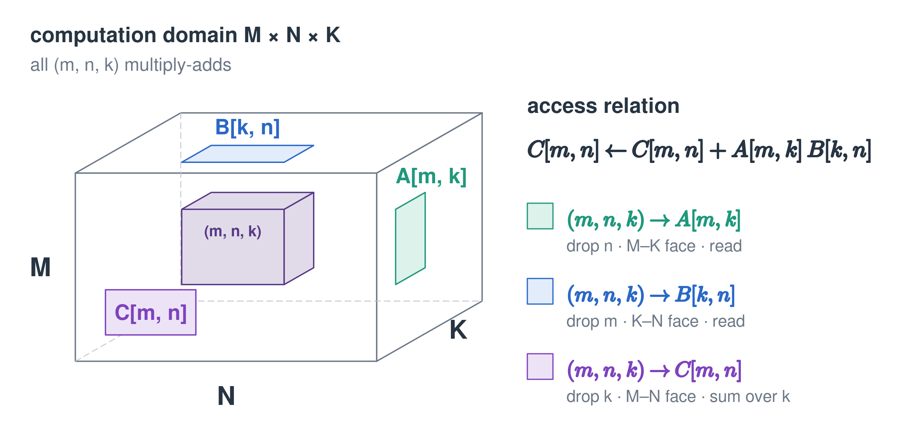{ width="65%" }

/// caption | #fig-1
图 1　GEMM 的计算域，以及一块计算在三个面上的投影
///

**数值契约**（numerical contract）约束数值类型：输入、累加与输出各用什么类型，归约允许怎样重新结合。本例为 BF16 输入、FP32 累加、BF16 输出；只有契约允许重新结合时，归约才能重排或拆成部分和。

以上是从算法的视角来看。换到硬件的视角，LLM 中的大部分计算由矩阵指令完成。与一次只处理一个元素的标量指令不同，矩阵指令一次完成一整块 tile 的乘加，这块计算有固定的形状。因此，矩阵指令也有自己的计算域，即它一次完成的全部运算：WGMMA 一次完成形状为 $64 \times n \times 16$ 的乘加，`mma.sync` 一次完成形状为 $16 \times 8 \times 16$ 的乘加（[图 2](#fig-2)）。我们把这类以 tile 为单位、形状固定的硬件指令称为 **atom**指令，把它的计算域称为 **atom domain**。选择指令并安排它们完成整个计算，就是把 atom domain 的各次实例映射到算子的计算域上，覆盖算子要求的全部计算：选择使用的 atom 类型、执行的顺序，以及它们读写的数据放在哪里。TileFoundry 正是以 atom 指令为单位描述 schedule，因此称之为 **atom schedule**。

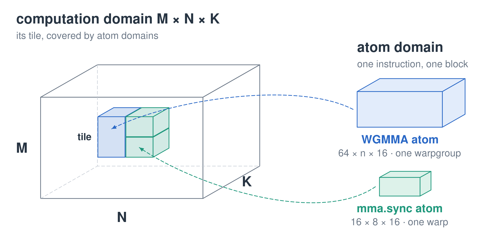{ width="65%" }

/// caption | #fig-2
图 2　atom domain 怎样覆盖算子的计算域
///

### 已知条件、决策变量、约束条件与优化目标 { #mapping }

用 atom domain 覆盖算子的计算域，有许多种方式。给定算法与硬件，schedule 优化就是在满足算法语义与硬件约束的前提下，从这些方式中找出执行时间最短的一种。因此，我们可以把它看作一个约束优化问题，而一个约束优化问题通常包含四个要素：已知条件、决策变量、约束条件与优化目标，下面逐一说明。

**已知条件。** 求解从既定的事实出发：算法一侧给出计算域、访问关系与数值契约；硬件一侧给出执行单元的并行层级、存储层级及其容量，以及每条指令自带的约束（[图 3](#fig-3)）。schedule 只能在这些事实限定的范围内作选择，而不能改变它们。

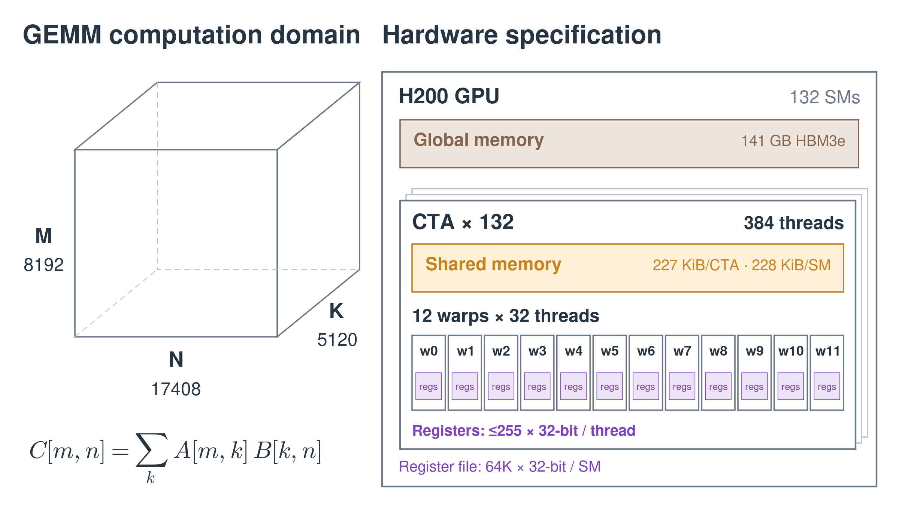{ width="65%" }

/// caption | #fig-3
图 3　求解所需的既定事实：左侧是算法一端，右侧是 H200 一端
///

**决策变量。** 在这些事实之上，需要求解的是 computation domain 与 atom domain 之间的映射。我们在大量 kernel 上的调优经验表明，决定性能的选择大多可以归结为四个关键策略，每个策略回答 schedule 中的一项关键决策：**空间映射**，即每一份计算由哪些执行单元完成；**执行顺序**，即各份计算以及数据搬运的先后；**数据放置**，即数据存放在哪一级存储、按什么布局排列；**指令选择**，即每一份计算由哪条指令完成（[图 4](#fig-4)）。循环展开、预取时机等，则可以看作在这四个决策点之上进一步的局部调优。

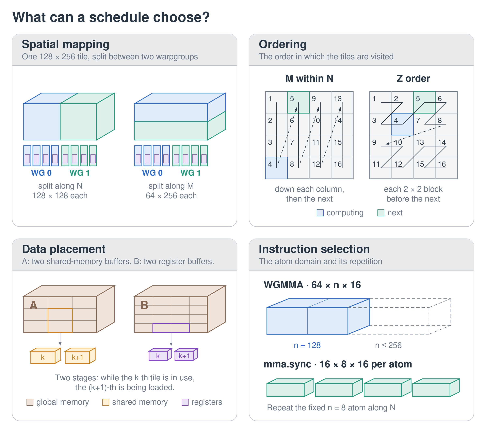{ width="75%" }

/// caption | #fig-4
图 4　四项关键决策，每项列出部分候选取值
///

**约束条件。** 这四项决策并不能任意组合，它们需要同时满足来自两端的约束：算法一端要求完成每一份计算，并保持依赖与数值精度；硬件一端要求满足指令对执行单元与操作数的规定，并且不超出每一级存储的容量（[图 5](#fig-5)）。SM 内部的调度、流水线、descriptor 编码等细节不在其中，交给 compiler 处理。

**优化目标。** 在满足约束的方案中，以最小化 kernel 的执行时间为目标。静态分析可以在生成代码之前估计计算量、搬运量、资源占用与性能，实测则给出真实的耗时，两者都可以用来比较候选方案。

### 求解 schedule 为什么困难 { #optimal }

求解 schedule 的困难主要来自两个方面：一是这四项决策各有许多候选，组合起来会形成很大的搜索空间；二是这些决策相互制约，很难分别求出各自的最优解再组合起来。

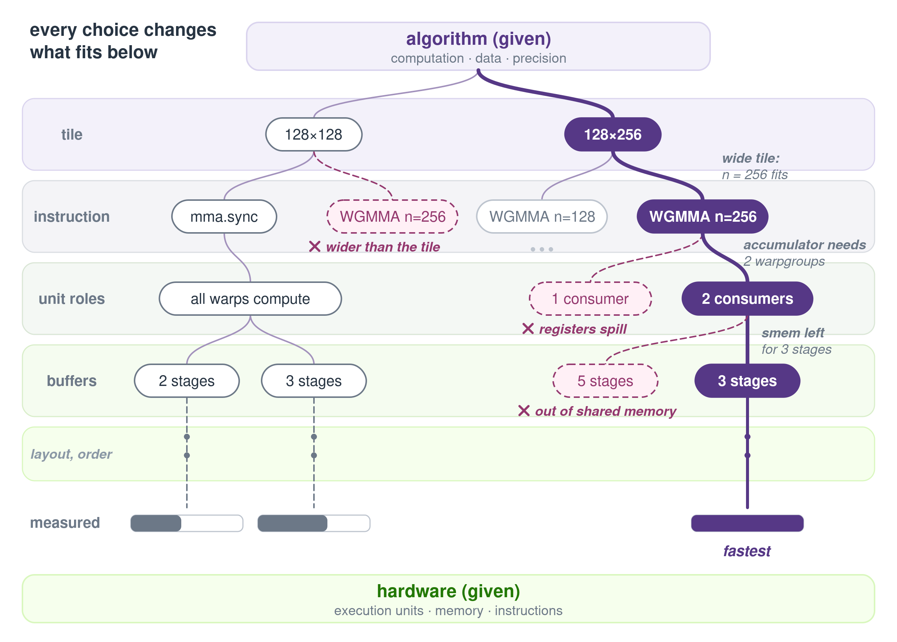{ width="85%" }

/// caption | #fig-5
图 5　候选组合怎样被约束：紫色路径是本例的最快方案（树的展开顺序不代表求解顺序）
///

**指令契约限制可行的组合。** 一条指令的 atom domain、执行单元与操作数要求，会同时约束多项决策。在本例中，如果选用 WGMMA 的 SS 形式，计算就需要以 warpgroup 为单位执行，两个输入操作数都要放在 shared memory 中，tile 的形状还要能分解为所选 atom domain 的整数次重复。而选择 mma.sync 就可以获得更加宽松的 tile 形状、执行单元约束。

**资源容量把不同的选择联系在一起。** tile 越大、consumer 越多，每个线程需要持有的 accumulator 就越多；缓冲级数越多，占用的 shared memory 也越多。以[图 5](#fig-5) 为例，$128 \times 256$ 的 tile 配合 $BK=64$ 时，每级缓冲中的 BF16 输入 $A$、$B$ 合计占用 48 KiB，5 级就需要 240 KiB，超过了单个 CTA 227 KiB 的上限。因此，被排除的是分块与缓冲级数的这一组合，而不是其中某一项单独的决策。

**满足约束的方案之间，仍需比较性能。** 更大的 tile 可以增加数据复用，也会占用更多资源；更多级缓冲可以让搬运与计算更充分地重叠，也会消耗更多 shared memory。这些收益与代价需要放在同一个方案中权衡，调整其中一项，往往也需要重新调整其他几项。

***因此，要让 agent 求解这个优化问题，就需要把隐含在代码背后的决定与约束显式地写出来，使 agent 能够以任意顺序反复修改相关的选择，并在每次修改后查询事实、检查约束、评价代价。***

## 为 agent 组织求解 { #background }

上一节的分析表明，schedule 是一组相互牵连的选择，需要放在一起反复调整。回顾 AI compiler 的发展，求解这组选择的方法大致经历了 progressive lowering、autotuning 与 coding agent 三个阶段（[图 6](#fig-6)）。TileFoundry 的 schedule 设计，正是从 coding agent 的工作特点出发的。

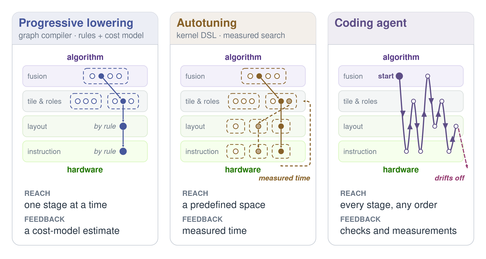{ width="85%" }

/// caption | #fig-6
图 6　三种求解方式能触及的范围与得到的反馈
///

**Progressive lowering 把联合优化拆成逐级可解的子问题。** 每一层 IR 暴露当前阶段的决定，由启发式规则与 cost model 一次性做出，再 lower 到下一层；pass 的顺序由专家预先固定，形成一条 pass pipeline。这样拆开之后，每个子问题小到规则与 cost model 能够处理，各阶段也能独立开发、在不同硬件间重用。代价是单向性：***向下 lower 容易，反过来则困难得多。*** Lowering 把高层的表达逐步展开为细节，向上则要从展开后的细节中重新还原出高层的结构化信息和语义。Lower 伴随着信息的丢失，下游又建立在上游确立的不变量之上；信息一旦在某一层被抽象掉，之后的各层就很难再利用它，由此错过的优化机会也很难再找回（[图 7](#fig-7)）。

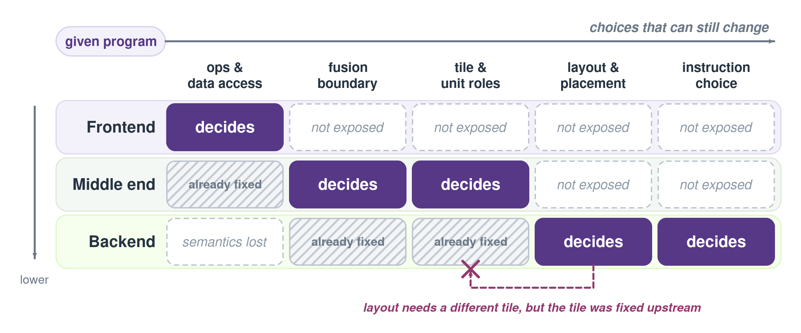{ width="80%" }

/// caption | #fig-7
图 7　单向 lowering：横轴是可以改变的优化选择，纵轴是 lower 的层级
///

**Autotuning 用实测迭代搜索，但搜索空间通常需要预先固定。** 在 GPU 与专用加速器上，参数稍有变化，性能就可能大幅跳变，progressive lowering 所依赖的启发式规则与 cost model 越来越难以准确预测。于是性能调优转向 autotuning：先生成候选方案，再编译和测量，并根据耗时继续搜索；但搜索空间通常由人预先写成模板或生成规则，调整参数比较容易，改变程序结构则比较困难，反馈也多半只有耗时。

无论是依靠规则与 cost model，还是借助 autotuning，今天的 AI compiler 大多仍建立在 progressive lowering 之上：决定逐级作出，一经作出便固定下来。

**Coding agent 的工作原理，决定了它的优化路径往往是曲折的，很难按预先设定的顺序推进。** Agent 是经过强化学习训练的概率模型，具备一定的分析与决策能力，对反馈中的锚点十分敏感；它的优化过程常常是往复的：在各层之间尝试、回退、再修改。而在非 agent 时代形成的 progressive lowering 体系中，上游的决定一旦由 pass pipeline 固定，agent 就不容易再回到那一层修改。反过来，如果完全放开限制，让 agent 直接编写 kernel，路径一长又容易发散，思维链中也可能出现幻觉（见[上一篇](AI-compilers-in-the-agentic-era.md#hard)）；缺少客观事实的校验时，agent 甚至可能声称方案已经最优，而实际上仍有提升空间。

在设计 TileFoundry 的过程中，我们一再观察到，把系统摊平、把所有信息都交给 agent 去尝试，并不是最好的做法：信息越庞杂，agent 的尝试就越容易随机、发散。为 agent 设计的 schedule，应当围绕 agent 的工作原理展开，让它把注意力放在那些可以求解、可以验证的关键问题上；与编程模型相关的实现细节，则从求解过程中剥离出来，交给代码生成。

Agent 具备决策与代码生成能力；抽象的层级因此可以减少：算法语义与硬件事实之间的路径越短，关键决策就越直接地受到约束，也就越容易验证。

另一方面，我们无法控制 agent 的决策顺序，所以系统不宜像 pass pipeline 那样固化求解顺序，而应在每一个关键的决策点上，随时给出事实与检查。这两点正是 TileFoundry 设计 atom schedule 的出发点。

> ***要加速 agent 优化 kernel，就应当尽量把与决策无关的细节抽象掉，让 agent 在每个决策上都目标清晰；而每个决策所需的事实，都应当可以查询、可以校验。***

## TileFoundry 的 atom schedule { #atom-schedule }

基于这两点，TileFoundry 设计了 atom schedule：以 atom 指令为单位描述 schedule（见[前文](#entities)）。在这一设计中，**agent 需要回答的只有数据流的切分、调度与指令选择这几个问题。通过清晰的抽象，我们让 agent 把注意力集中在这几项最关键的决策上，并让这些决策始终受到硬件事实的约束；在此之外，则由 agent 凭借自身的推理与判断自主决策。系统在这些决策点上随时给出事实与检查，至于按什么路径求解，则由 agent 自己决定**；descriptor、barrier 与同步这类实现细节，则交给 compiler 与后端处理，不进入 agent 的求解。这样，求解可以更快地收敛到好的方案，而不只是依靠算力与模型中积累的知识反复随机尝试。

要做到这一点，前文讨论的约束优化问题的四个要素在系统中都需要有显式、明确的表示。[表 1](#tbl-1) 列出了它们在 TileFoundry 中对应的抽象。

| 问题的要素 | TileFoundry 中的抽象 |
| --- | --- |
| 已知条件 | HIR 写出计算与各操作的 `AccessRelation`；target 声明并行层级、存储容量与可用的指令 |
| 决策变量 | Layout 系统表示空间映射与数据放置；`tf.schedule` 表示指令选择，并附带 `repeat` 参数；HIR 中的循环、`tf.schedule` 的 `order` 与缓冲的 `buffers` 表示执行顺序 |
| 约束条件 | 指令契约规定每条指令对执行单元与操作数的要求，硬件并行度、容量上限 |
| 优化目标 | 最小化执行时间；`analyze` 在生成代码之前估计代价，实测给出真实耗时 |

/// caption | #tbl-1
表 1　约束优化问题的四个要素与 TileFoundry 中对应的抽象
///

上述抽象编码在同一套系统内，能在 agent 求解的过程中提供三种能力：

1. **推导：改动一项决策时，相关的类型随之更新。** Agent 改动一处分工或布局时，Layout 系统会根据各操作的 `AccessRelation`，[推导出下游操作的分布](https://github.com/tile-ai/TileFoundry/blob/25fbbaae20a06a453b4e41920b64fbe425282900/docs/spec/semantic-analysis.md#3-shard-propagation)；`tf.schedule` 则按指令契约，把 tile 的类型分解为 atom domain 的重复（[`repeat`](https://github.com/tile-ai/TileFoundry/blob/25fbbaae20a06a453b4e41920b64fbe425282900/docs/spec/schedule.md#3-repeat-and-order)）与操作数 fragment，agent 写下的 `repeat` 必须与推导结果一致。
2. **回答：需要事实或代价时，随时可以查询。** [`schedule facts`](https://github.com/tile-ai/TileFoundry/blob/25fbbaae20a06a453b4e41920b64fbe425282900/docs/spec/cli.md#schedule) 给出一条指令的完整契约，[`schedule candidates`](https://github.com/tile-ai/TileFoundry/blob/25fbbaae20a06a453b4e41920b64fbe425282900/docs/spec/cli.md#schedule) 列出当前位置可用与被拒绝的指令及理由，[`analyze`](https://github.com/tile-ai/TileFoundry/blob/25fbbaae20a06a453b4e41920b64fbe425282900/docs/spec/cli.md#analyze) 则依据 target 声明的硬件事实，估计方案的计算量、搬运量、容量与性能。
3. **检查：方案违反约束时，立即指出问题所在。** 如果程序中的 Mesh 与操作数类型对不上指令契约中的 [execution mesh 或 operand pattern](https://github.com/tile-ai/TileFoundry/blob/25fbbaae20a06a453b4e41920b64fbe425282900/docs/spec/tir.md#execution-meshes)，方案就会被拒绝，报告会指出是哪一项不匹配。

这三种能力之所以成立，是因为程序和指令契约都由 Layout 系统表达，数据分布与 `tf.schedule` 又写在同一份 HIR 里，compiler 可以直接把程序和契约放在一起推导、对照。

下面依次介绍支撑这些能力的三个核心部分：Layout 系统、`tf.schedule`，以及 target 与指令契约。

### Layout 系统 { #layout }

[Layout 系统](https://github.com/tile-ai/TileFoundry/blob/25fbbaae20a06a453b4e41920b64fbe425282900/docs/spec/shard.md)用来写出空间映射与数据放置。这两项决策彼此牵动，所以用同一套概念写出（[表 2](#tbl-2)）。它们被记录在 HIR 的 Mesh 作用域与张量类型中；改动其中一处，compiler 会根据每个操作的 `AccessRelation` 重新推导相关的类型。

| 概念 | 含义 |
| --- | --- |
| [`Topology`](https://github.com/tile-ai/TileFoundry/blob/25fbbaae20a06a453b4e41920b64fbe425282900/docs/spec/shard.md#5-mesh) | 并行层级中的一层，声明这一层执行单元的最大并行度 |
| [`Mesh`](https://github.com/tile-ai/TileFoundry/blob/25fbbaae20a06a453b4e41920b64fbe425282900/docs/spec/shard.md#5-mesh) | 把一段计算按逻辑形状排列，并映射到某一层的执行单元上 |
| [`Layout`](https://github.com/tile-ai/TileFoundry/blob/25fbbaae20a06a453b4e41920b64fbe425282900/docs/spec/shard.md#2-layout-hierarchy) | 数据坐标到存储偏移的映射，可组合 `Swizzle` |
| [`ShardLayout`](https://github.com/tile-ai/TileFoundry/blob/25fbbaae20a06a453b4e41920b64fbe425282900/docs/spec/shard.md#7-shardlayout) | 一个 `Layout` 加一个 `Mesh`：哪个执行单元持有哪部分数据、本地如何排列 |
| [`reshard`](https://github.com/tile-ai/TileFoundry/blob/25fbbaae20a06a453b4e41920b64fbe425282900/docs/spec/shard.md#74-reshard-preserves-logical-shape) | 改变一个值的分布、布局或存储层级，逻辑形状不变 |

/// caption | #tbl-2
表 2　Layout 系统中的概念
///

### `tf.schedule` { #schedule }

[`tf.schedule`](https://github.com/tile-ai/TileFoundry/blob/25fbbaae20a06a453b4e41920b64fbe425282900/docs/spec/schedule.md) 是 HIR 中的一个特殊函数，用来写下指令选择：它为一个 tile 操作选定一条 atom 指令，并按指令契约把这个 tile 分解为 atom domain 的若干次重复（`repeat`），以及每次重复中单个 atom 读写的操作数片段。指令选择因此写在 HIR 这一层，而不是在某一级 lowering 中固定下来；上层的分工改变时，tile 的类型随之改变，这一分解也会重新推导。

### Target 与指令契约 { #contract }

Target 与指令契约给出硬件的事实与约束。

* [Target](https://github.com/tile-ai/TileFoundry/blob/25fbbaae20a06a453b4e41920b64fbe425282900/docs/spec/target.md) 声明并行层级与存储容量（如 [H200 的声明](https://github.com/tile-ai/TileFoundry/blob/25fbbaae20a06a453b4e41920b64fbe425282900/src/tilefoundry/target/cuda/hardware/nvidia_h200_sxm.toml)）；
* 指令契约声明每条指令由哪些执行单元执行，操作数的形状、存储与布局，以及参数的取值范围（如 [WGMMA 的契约](https://github.com/tile-ai/TileFoundry/blob/25fbbaae20a06a453b4e41920b64fbe425282900/src/tilefoundry/ir/tir/cuda/nn/wgmma.py)）。

契约本身也用 Layout 系统写成，所以检查一个方案，就是检查它的类型能否与契约匹配；检查与修改顺序无关，只拒绝违反硬性条件的方案。硬件的知识集中在 target 与指令契约中，因此**接入一种新的硬件，主要是写出它的 target 与指令契约，Layout 系统与 `tf.schedule` 的写法并不需要改变**。M2 Pro 上的 [AMX](https://github.com/tile-ai/TileFoundry/blob/25fbbaae20a06a453b4e41920b64fbe425282900/docs/spec/target.md#9-amxtarget) 就是这样接入的，[实测](#amx)一节会具体介绍。

## 实例：用 TileFoundry 求解 H200 上的 GEMM { #solve }

回到前文 H200 上的 GEMM 例子。下面按程序的顺序，逐段介绍 agent 借助 TileFoundry 为本例找到的最快方案，并说明每一段对应哪一项决策，以及这项决策怎样借助查询与分析得到反馈[^tutorial]。

**介绍的顺序并不代表实际求解时的决策顺序：agent 会根据查询、分析与实测的反馈，在这些决策之间往返调整，这正是它与 pass pipeline 的不同之处。**

### 空间映射与执行顺序 { #ex-spatial }

程序首先给出 CTA 一级的空间映射与执行顺序，即各个 CTA 分别计算哪一块输出、以什么顺序处理这些输出块。下面的片段来自 tutorial 中 [`optimal.py`](https://github.com/tile-ai/TileFoundry/blob/25fbbaae20a06a453b4e41920b64fbe425282900/docs/tutorial/schedule.md?plain=1#L256-L364)：

```python
# M, N, K = 8192, 17408, 5120;  BM, BN, BK = 128, 256, 64
# GM, GN = M // BM, N // BN = 64, 68;  CTAS = 132
@module(
    entry="gemm",
    target=CudaTarget("nvidia.h200_sxm"),
    topologies=(Topology("cta", CTAS), Topology("thread", 384)),
)
class GEMM_8192X17408X5120_OPTIMAL:
    @func
    def gemm(a: Tensor[(M, K), "bf16"], b: Tensor[(K, N), "bf16"]) -> Tensor[(M, N), "bf16"]:
        with Mesh(("cta",), layout=(CTAS,), names=("persistent",)) as cta:
            with Mesh(("thread",), layout=(3, 128), names=("warpgroup", "participant")) as threads:
                ...
                for task in range(cta.persistent, GM * GN, CTAS):
                    ...  # 由 task 求出这个输出 tile 的起点 m、n
```

这几行写下了 CTA 一级的两项决策。`topologies` 声明可用的并行层级，是求解的已知条件；在此之上，Mesh 给出空间映射，`for task` 循环给出执行顺序。

**声明并行层级。** `topologies` 声明程序用到的并行层级以及每一层的规模，即 Topology[^notation]（[图 8](#fig-8)）：

$$
\mathcal{T}_{\mathrm{CTA}}=(132),\qquad
\mathcal{T}_{\mathrm{thread}}=(384).
$$

**组织执行单元。** Mesh 在这些并行层级之上，把执行单元按逻辑形状排列。CTA Mesh 只有一个轴 `persistent`，依次排列全部 132 个常驻的 CTA；线程 Mesh 把 CTA 内的 384 个线程排成 3 个 warpgroup，每个 warpgroup 128 个线程：

$$
\mathcal{M}_{\mathrm{CTA}}=
\begin{bmatrix}132@\mathrm{persistent}\\1\end{bmatrix},\qquad
\mathcal{M}_{\mathrm{thread}}=
\begin{bmatrix}3@\mathrm{warpgroup}&128@\mathrm{participant}\\128&1\end{bmatrix}.
$$

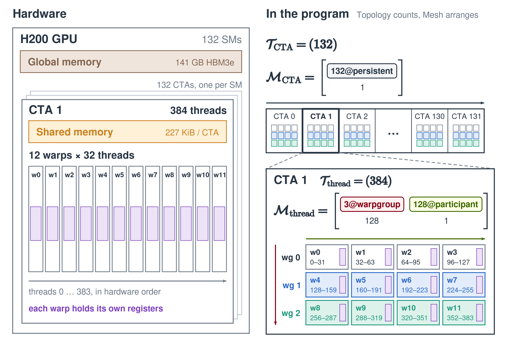{ width="75%" }

/// caption | #fig-8
图 8　左侧是 H200 的硬件层级，右侧是程序中的 Topology 与 Mesh；对照两侧的 CTA 1，重新组织 12 个 warp 
///

**分配输出 tile。** 输出共有 $64 \times 68 = 4352$ 个 $128 \times 256$ 的 tile，远多于 132 个 CTA。循环 `for task in range(cta.persistent, GM * GN, CTAS)` 让 CTA 常驻，依次处理多个 tile：CTA $p$ 处理编号为 $p$、$p+132$、$p+264$……的 tile。

这几项选择在生成代码之前就可以得到检查。Agent 改写 CTA 的分配后，调用 `tilefoundry analyze` 分析当前的 HIR：为每个输出 tile 启动一个 CTA 需要 33 个 wave，改用 132 个常驻 CTA 只需 1 个；按 $M$ 依次遍历时，$B$ 的 L2 复用窗口超出了 L2 的容量。后一条事实提示需要把 tile 分组遍历；至于每组多大，`analyze` 的预测无法回答，由实测来确定。这样，agent 在决定空间映射时，就能随时查到这项决策所需的事实。

### 指令选择 { #ex-contract }

指令选择依靠指令契约。Agent 可以用两条命令查询：`schedule candidates` 针对每个尚未选择指令的位置，列出能实现它的指令，以及被拒绝的指令和理由；`schedule facts` 给出一条指令的完整契约。不匹配的选择在实测之前就会被拒绝，报告会指出是哪一项对不上。

**查询候选。** 高层的 `tf.matmul` 只确定了要计算什么，还没有决定用哪条指令实现。以 tutorial 中的基线 [`grid.py`](https://github.com/tile-ai/TileFoundry/blob/25fbbaae20a06a453b4e41920b64fbe425282900/docs/tutorial/schedule.md?plain=1#L29-L66) 为例：它尚未选择任何指令，也没有线程一级的 Mesh；每个输出 tile 由一个 CTA 计算，所以 CTA 一级的 Topology 是 $64 \times 68 = 4352$。对它查询候选：

```bash
tilefoundry schedule candidates grid.py candidates.txt
sed -n '/tf.matmul/,+6p' candidates.txt
```

```python
  part:31  tf.matmul  per cta  lhs=Tensor[(128, 64), "bf16", "smem"]  rhs=Tensor[(64, 256), "bf16", "smem"]  result=Tensor[(128, 256), "f32", "rmem"]
    refused     T.cuda.sm90.Wgmma  dtype=f16, form=SS, a_major=MN, b_major=MN
                  mesh: Mesh((Topology("cta", 4352),), layout=(64, 68), names=("bm", "bn")) does not match Mesh(('thread',), ComposedLayout(None, p0, Layout(((*g, 4, 8, 4),), ((*gs, 32, 4, 1),))))
    refused     T.cuda.sm80.Mma
                  mesh: Mesh((Topology("cta", 4352),), layout=(64, 68), names=("bm", "bn")) does not match Mesh(('thread',), ComposedLayout(None, p0, Layout(((*g, 4, 8),), ((*gs, 1, 4),))))
    refused     T.cuda.sm89.Mma
                  mesh: Mesh((Topology("cta", 4352),), layout=(64, 68), names=("bm", "bn")) does not match Mesh(('thread',), ComposedLayout(None, p0, Layout(((*g, 4, 8),), ((*gs, 1, 4),))))
```

这些指令都要求在 thread mesh 上执行，而基线的 `tf.matmul` 只处在 CTA mesh 中，所以每一条候选都在 Mesh 匹配这一步被拒绝；完整报告中的 `T.binary` 与 `T.cast` 也是如此。拒绝的理由指出了缺少线程一级的组织，`optimal.py` 中的线程 Mesh 补上的正是这一部分。

**查询契约。** 接着读取 WGMMA 在目标硬件上的契约：

```bash
tilefoundry schedule facts T.cuda.sm90.Wgmma --target nvidia.h200_sxm Wgmma.facts.txt
sed -n '1,30p' Wgmma.facts.txt
```

```python
T.cuda.sm90.Wgmma
  target             nvidia.h200_sxm
  target capability  wgmma.mma_async
  execution mesh     Mesh(('thread',), ComposedLayout(None, p0, Layout(((4, 8, 4),), ((32, 4, 1),))))
                       predicates:
                         each top-level mode has no backward step
                         each top-level mode reaches each of its own slots exactly once
                         p0 % 128 == 0
  parameters
    n        any value
               predicates:
                 8 <= n <= 256
                 n % 8 == 0
    dtype    any value
               predicates:
                 dtype in {bf16, f16, fp8e4m3}
    form     any value
               predicates:
                 form in {Form.SS, Form.RS}
    a_major  dtype=bf16, form=SS  a_major in {Major.MN, Major.K} (default Major.MN)
             dtype=bf16, form=RS  Major.K
             dtype=f16, form=SS   a_major in {Major.MN, Major.K}
             dtype=f16, form=RS   Major.K
             dtype=fp8e4m3        Major.K
    b_major  dtype=bf16     b_major in {Major.MN, Major.K} (default Major.MN)
             dtype=f16      b_major in {Major.MN, Major.K}
             dtype=fp8e4m3  Major.K
  operands
    C  shape=(64, n) dtype=f32 storage=rmem, held in 1 arrangement:
         ShardLayout(Layout((4, 2, 8, c, 4, 2), (16, 8, 1, 512, 128, 64)), (S(0), S(2), S(4)), Mesh(('thread',), ComposedLayout(None, p0, Layout(((4, 8, 4),), ((32, 4, 1),)))))
```

`execution mesh` 要求一条 WGMMA 由一个 warpgroup 执行：$4 \times 8 \times 4 = 128$ 个线程，起始线程 `p0` 按 128 对齐。`parameters` 列出 `n`、`dtype`、`form` 等参数的取值范围，其中 `a_major` 的取值随 `dtype` 与 `form` 变化。`operands` 要求 $64 \times n$ 的 f32 accumulator `C` 位于寄存器，并给出它的 ShardLayout，后文的 $\mathcal{L}_C$ 按它绑定线程。

两份报告的粒度不同：`candidates` 针对当前 HIR 中每个尚未选择指令的位置，`facts` 给出单条指令的契约。Agent 依据它们决定怎样用指令覆盖 tile、由哪些执行单元执行、让数据满足哪种布局；与空间映射一样，这项决策所需的事实，也能在作出决策时随时查到。

### 在同一份 HIR 中写出全部选择 { #ex-schedule }

查询与分析得到的结论，最终都要写进程序。在 `optimal.py` 中，四项决策写在同一份 HIR 里：Layout 系统写出执行单元的组织与数据的布局，`tf.schedule` 写出指令选择。下面是其中一个输出 tile 的程序。`m`、`n` 是当前 tile 的起点，`threads` 是上文的线程 Mesh，`out` 是输出张量；`BM=128`、`BN=256`、`BK=64`、`STAGES=3`。高亮的行按注释编号（1）至（7）逐项说明，括号中是对应的决策。

```python hl_lines="1 3 4 7 8 9 10 11 14 19 23"
wgmma = T.cuda.sm90.Wgmma(n=256, dtype="bf16", form=T.cuda.sm90.Form.SS, a_major=T.cuda.sm90.Major.K)  # (1)

with Mesh(threads[1:3, :], layout=(2, 4, 8, 4), names=("group", "warp", "lane8", "lane4")) as _compute:  # (2)
    acc = tf.zeros(Tensor[(BM, BN), "f32", ((2 @ _compute.group, 4 @ _compute.warp, 2, 8 @ _compute.lane8, 32, 4 @ _compute.lane4, 2), (16384, 16, 8, 1, 512, 128, 64)), "rmem"])  # (3)

for k in tf.tile(K, BK):
    with threads[0, :32] as _loader:  # (2)
        lhs_ring = tf.empty(Tensor[(128, 64), "bf16", Layout(((2, 8, 8), (4, 16)), ((4096, 512, 64), (16, 1))) | Swizzle(3, 4, 3), "smem"], buffers=STAGES)  # (4)
        lhs = tf.schedule((a[m:m + BM, k], lhs_ring), op=T.copy_async_tensor())  # (5)
        rhs_ring = tf.empty(Tensor[(64, 256), "bf16", Layout(((4, 2, 8), (4, 64)), ((4096, 512, 64), (1024, 1))) | Swizzle(3, 4, 3), "smem"], buffers=STAGES)  # (4)
        rhs = tf.schedule((b[k, n:n + BN], rhs_ring), op=T.copy_async_tensor())  # (5)

    with Mesh(threads[1:3, :], layout=(2, 4, 8, 4), names=("group", "warp", "lane8", "lane4")) as _compute:
        acc = tf.schedule((acc, lhs, rhs), op=T.tiled_mma(atom=wgmma), repeat=(2, 1, 4))  # (6)

with Mesh(threads[1:3, :], layout=(2, 4, 8, 4), names=("group", "warp", "lane8", "lane4")) as _compute:
    tile_out = tf.cast(acc, dtype="bf16")
    staged_dst = tf.empty(Tensor[(128, 256), "bf16", Layout((128, (4, 64)), (64, (8192, 1))) | Swizzle(3, 4, 3), "smem"])
    staged = tf.schedule((tile_out, staged_dst), op=T.copy())  # (7)

with threads[0, :32] as _storer:
    tile_dst = tf.empty(Tensor[(128, 256), "bf16", (128, 256)])
    tile = tf.schedule((staged, tile_dst), op=T.copy_async_tensor())  # (7)
    out = tf.insert_slice(out, tile, (m, n))
```

**（1）指令 atom（指令选择）。** `wgmma` 选定的 WGMMA（BF16、SS 形式、$n=256$）一次覆盖 $64 \times 256 \times 16$ 的计算。`facts` 中 $n$ 的上限是 256，这是 BF16 WGMMA 能取的最大形状，所需的指令条数最少。

**（2）执行单元的分工（空间映射）。** CTA 内的线程采用 warp specialization：`threads[0, :32]` 是 producer，负责搬运；`threads[1:3, :]` 是两个 consumer，负责计算；双方通过 shared memory 协作。两个 consumer 重新组织成计算用的 Mesh（[图 9](#fig-9)）：

$$
\mathcal{M}_{\mathrm{compute}}=
\begin{bmatrix}
2@\mathrm{group}&4@\mathrm{warp}&8@\mathrm{lane8}&4@\mathrm{lane4}\\
128&32&4&1
\end{bmatrix}+128.
$$

每个 consumer 的 $4 \times 8 \times 4$ 组织，正是 WGMMA 契约中的 `execution mesh`（见[指令选择](#ex-contract)）。

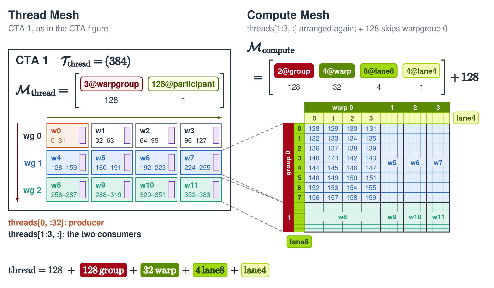{ width="68%" }

/// caption | #fig-9
图 9　两个 consumer 从线程 Mesh 中切出，重新组织成 $\mathcal{M}_{\mathrm{compute}}$；右侧矩阵的每格是一个线程
///

**（3）accumulator 的分布（数据放置）。** `acc` 的类型是一个 ShardLayout，写出两个 consumer 的 256 个线程各持有 accumulator 的哪些元素（[图 10](#fig-10)）：

$$
\mathcal{L}_C=
\begin{bmatrix}
2@\mathrm{group}&4@\mathrm{warp}&2&8@\mathrm{lane8}&32&4@\mathrm{lane4}&2\\
16384&16&8&1&512&128&64
\end{bmatrix}.
$$

最外层的 `2@group` 把 accumulator 分给两个 consumer；组内的部分与 `facts` 中 $C$ 的 ShardLayout 一致（见[指令选择](#ex-contract)）。

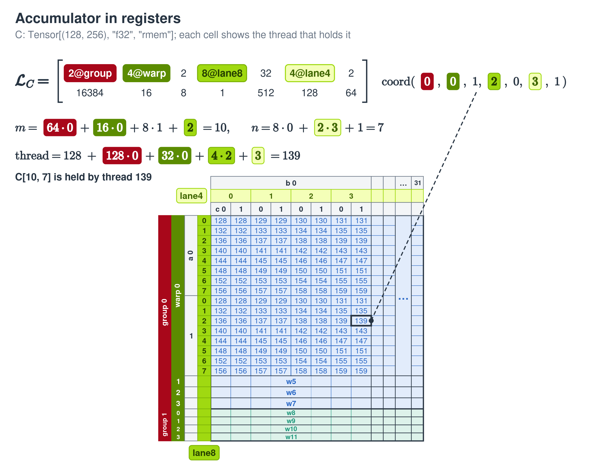{ width="68%" }

/// caption | #fig-10
图 10　沿虚线看一个坐标经 $\mathcal{L}_C$ 落到哪个元素，由哪个线程持有
///

**（4）$A$、$B$ 的布局与缓冲（数据放置、执行顺序）。** `buffers=STAGES` 为 $A$、$B$ 各声明 3 个轮换的缓冲槽，下一块数据的搬运因此可以与当前块的计算重叠。缓冲槽的类型写出 $A$、$B$ 在 shared memory 中的布局（[图 11](#fig-11)），以 $A$ 为例：

$$
\mathcal{L}_A=\mathrm{Swizzle}_{3,4,3}\circ
\begin{bmatrix}2&8&8&4&16\\4096&512&64&16&1\end{bmatrix}.
$$

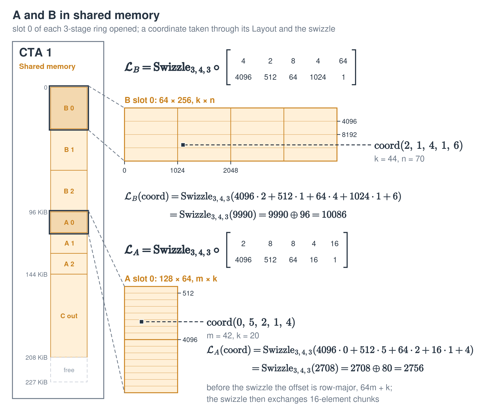{ width="68%" }

/// caption | #fig-11
图 11　左侧是 shared memory 的分配，右侧放大 $A$、$B$ 的 slot 0；沿虚线看一个坐标经 stride 与 swizzle 落到哪个偏移
///

**（5）TMA 搬运（指令选择）。** 两处 `tf.schedule` 由 producer warp 发起，用 TMA（`T.copy_async_tensor`）把 $A$、$B$ 的 tile 搬入（4）中的缓冲槽。

**（6）WGMMA 计算（指令选择）。** tile 是 $128 \times 256 \times 64$，atom 是 $64 \times 256 \times 16$，所以 `repeat=(2,1,4)`：$M$ 方向的两份对应 $\mathcal{L}_C$ 的 `2@group`，每个 consumer 沿 $K$ 做四次。`repeat` 由 tile 与 atom 的形状推出，写下的值与推导结果不一致时会被拒绝。

**（7）输出。** FP32 accumulator 先由 `tf.cast` 转换为 BF16，经 `T.copy()` 暂存到 shared memory，再由 producer warp 用 TMA 写回 global memory。

其余操作，包括沿 $K$ 的遍历、切片、`tf.zeros`、`tf.cast` 与 `tf.insert_slice`，都保留高层表达。Agent 只写出与四项决策有关的指令和布局，其余的实现细节交给代码生成。

### 生成 TIR 与分析 { #ex-analysis }

对写好的 HIR，`schedule finalize` 把选定的指令 lower 成 TIR 并加以验证，同时运行内存分析；实测的结果再提示 agent 需要回头调整哪一项决策。Agent 不必直接编写 TIR，TIR 之下的实现可以是 TileLang、Triton、CUDA C，甚至 PTX。

对 [`optimal.py`](https://github.com/tile-ai/TileFoundry/blob/25fbbaae20a06a453b4e41920b64fbe425282900/docs/tutorial/schedule.md?plain=1#L256-L364) 运行 `analyze --memory`，shared memory 峰值为 208.00KB，在单个 CTA 227KB 的上限之内，寄存器为 128.00KB。报告也给出每个缓冲的复用窗口，以 $A$ 为例：

```text
#   buffer=a holds=944.00KB time=none space=cta.persistent reuse=2.05MB fits=yes precision=upper_bound
```

其中 `reuse` 是复用窗口，`fits=yes` 表示报告判定它不超过容量，`precision=upper_bound` 表示这是一个上界估计。容量分析的结果只作为诊断信息保留，容量问题本身不会让 `finalize` 拒绝程序。静态检查与预测有助于比较候选方案，运行时的正确性与实际性能仍要靠执行验证和 GPU 测量。

接着运行 `finalize`，把这份 HIR 转换为 TIR：

```bash
tilefoundry schedule finalize optimal.py optimal_tir.py
```

`finalize` 检查入口、进行内存分析、把指令选择转换为 TIR，再验证生成的 primitive function。在生成结果中，HIR 的 `buffers=3` 变成三个不同偏移的 tensor view，以及一个取模的槽位选择：

```python
lhs_ring_stages = (
    T.tensor_view(98304, dtype="bf16", storage="smem", layout=Layout(((2, 8, 8), (4, 16)), ((4096, 512, 64), (16, 1))) | Swizzle(3, 4, 3), shape=(128, 64)),
    T.tensor_view(114688, dtype="bf16", storage="smem", layout=Layout(((2, 8, 8), (4, 16)), ((4096, 512, 64), (16, 1))) | Swizzle(3, 4, 3), shape=(128, 64)),
    T.tensor_view(131072, dtype="bf16", storage="smem", layout=Layout(((2, 8, 8), (4, 16)), ((4096, 512, 64), (16, 1))) | Swizzle(3, 4, 3), shape=(128, 64)),
)
...
for task in range(cta.persistent, 4352, 132):
    ...
    for k in range(0, 5120, 64):
        with scope[:1, :32] as scope_2:
            ...
            T.copy_async_tensor(
                value,
                lhs_ring_stages[((((task - cta.persistent) // 132) * 80) + (k // 64)) % 3],
            )
```

在 TIR 中，执行域仍然是 Mesh：`scope[:1, :32]` 选出第一组中的一个 warp 发起搬运，consumer 的 $2 \times 4 \times 8 \times 4$ 组织和 offset 128 也原样保留。

### 最终方案 { #ex-result }

至此，四项决策都已确定，合起来就是最终方案（[图 12](#fig-12)）。

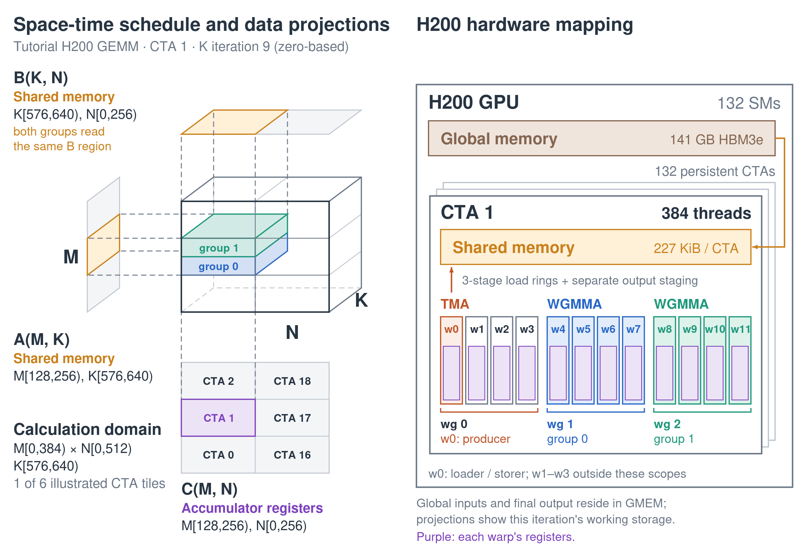{ width="75%" }

/// caption | #fig-12
图 12　最终方案：左侧是 CTA 1 一个 $K$ 步的计算与数据，右侧是它在 H200 上的执行单元与存储
///

在这个例子中，[TileFoundry 的 atom schedule](#atom-schedule)一节介绍的三个核心部分分别承担了以下作用：

1. **Layout 系统统一描述执行分工与数据分布。** `Mesh`、`Layout`、`ShardLayout` 用同一套 shape/stride 表示，agent 改动一处，compiler 重新推导相关的类型。本例中，线程 Mesh 与 accumulator 的 $\mathcal{L}_C$ 写在同一套表示里，$\mathcal{L}_C$ 的组内部分与 WGMMA 契约中 $C$ 的 ShardLayout 一致（见[在同一份 HIR 中写出全部选择](#ex-schedule)）。
2. **`tf.schedule` 让指令选择不再固定于某一级 lowering。** 它在 HIR 中为 tile 选定指令，并按契约推导出 `repeat` 与操作数 fragment；GEMM 的 `repeat=(2,1,4)` 就是这样确定的（见[在同一份 HIR 中写出全部选择](#ex-schedule)）。
3. **硬件契约提供合法性检查，也是接入新硬件的统一描述。** 不合法的选择在实测之前就被拒绝，并附有理由，例如基线缺少线程一级的 Mesh（见[指令选择](#ex-contract)）。接入新硬件主要是写出 target 与契约，M2 Pro 上的 AMX 也是这样接入的（见[实测](#amx)）。

因此，使用指令所需的硬件约束，可以写在 target 与契约中，而不必整理成一份供 agent 阅读的 kernel 文档：文档给出的是一般规律，契约则针对当前的程序，回答一条指令能否使用、为什么不能使用。

## 实测：模型、新硬件与算子库 { #experiments }

前文以单个 GEMM 为例，说明了 TileFoundry 的设计怎样支撑 agent 求解 schedule。这一节我们转向实际的应用，三组实验分别来自：

- **一个完整模型的 Prefill**：在 H200 上，agent 随输入长度调整计算的分配；
- **一种新的硬件**：在 M2 Pro 上，TileFoundry 通过写出 target 与指令契约接入 AMX；
- **一个真实的算子库 [TileOPs](https://github.com/tile-ai/TileOPs)**：记录这个算子库在约 11 周内的整体进展。

### H200 上的完整 Prefill：随输入长度调整计算分配 { #cuda }

第一个例子是 H200 上 Qwen3.8-27B 的完整 Prefill，模型包含 64 层 gated-delta-net 与 attention 的混合结构。Agent 从 checkpoint、TileLang 后端和 GPU 出发，通过 `tilefoundry` CLI 查询与分析，完成了模型 HIR、schedule 与运行时实现。

这里选取 128、256、512、1024 token 四种长度，与 SGLang 0.5.21 做同口径测量[^h200]。四种长度下，相对 SGLang 的加速比分别为 **1.88×、1.41×、1.10×、1.03×**，生成的首个 token 均与 SGLang、transformers 一致。

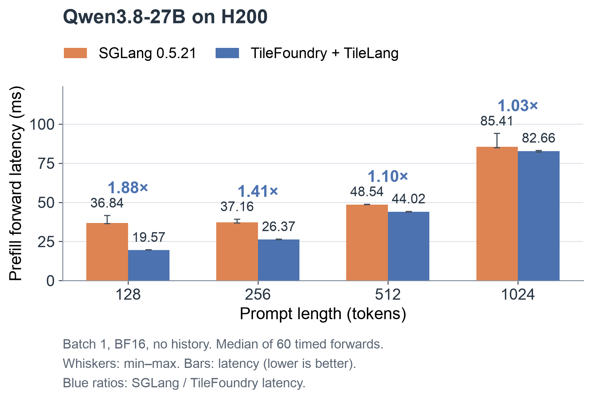{ width="62%" }

/// caption | #fig-13
图 13　H200 上完整 Prefill 的性能对比，误差线表示计时最小值与最大值
///

针对不同的输入长度，agent 调整了执行单元的分配与数据的驻留位置。下面以 attention core 中的两项调整为例；[图 13](#fig-13) 是完整 Prefill 的性能，下文的耗时只针对 attention core。`T=128` 时，调整前的方案只有 48 个 CTA，性能受限于单个 CTA 的延迟。

如[图 14](#fig-14) 上半部分所示，agent 把一个 `(head, query block)` 的 256 个输出维分配给两个 CTA。两个 CTA 都计算 QKᵀ 与 softmax，再各自完成 128 个输出维的 PV、gate 与写回。CTA 数量增加到 96，单个 CTA 的执行时间缩短，core 耗时从 12.4 微秒降到 10.0 微秒。

到了 `T=1024`，agent 转而增加同一 CTA 内的 K/V 复用。如[图 14](#fig-14) 下半部分所示，agent 把两个 query head 合并到一个 CTA 中，由两个 consumer warpgroup 分别计算各自的 P 与输出；结果留在各自的寄存器中，K/V 在 shared memory 中共享。CTA 数量从 384 降到 192，K/V 的重复读取减少，core 耗时从 55.7 微秒降到 45.2 微秒。这两项调整，一项改变输出维的切分，一项改变 head 的分组，改的都是执行单元与数据分布之间的对应关系；在 Layout 系统中，两者都通过修改这一映射来表达。

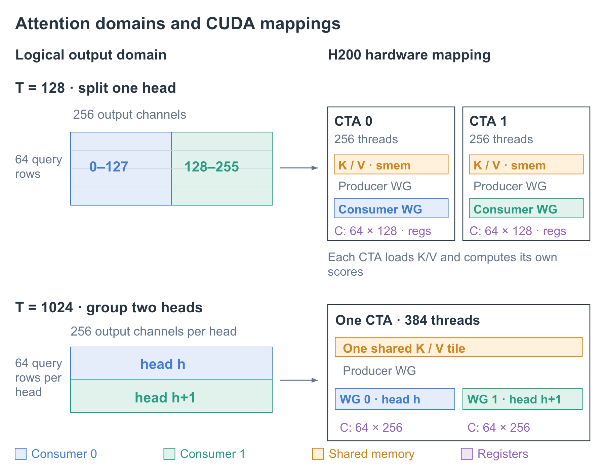{ width="62%" }

/// caption | #fig-14
图 14　Attention 的逻辑计算域与 CUDA 映射，上半部分拆分同一 head 的输出域，下半部分将两个 head 映射到同一 CTA
///

### M2 Pro 上的 AMX：接入新的硬件 { #amx }

TileFoundry 是一个 agent compiler framework，并不绑定某一种硬件。面向新硬件时，算法一侧仍描述相同的计算，四项决策也沿用前文的表达方式；agent 依据新硬件的契约，写出具体的 schedule。

**接入新硬件所需的声明。** 硬件契约也是新硬件接入 TileFoundry 的方式。支持一种硬件，需要提供 Target、硬件事实文档与指令声明三部分，compiler 直接读取它们：

1. **Target。** 声明这种硬件的拓扑层级，也就是 `Mesh` 可以使用的层级名：CUDA target 是 `gpu`、`cta`、`thread`，AMX target 是 `core`、`amx`。Target 把一份 Architecture 文档与一份 Device 文档组合起来，并提供这种硬件的分析器。

2. **硬件事实文档。** 每个 Architecture 与 Device 各有一份 TOML 文档，硬件相关的数字只写在这里：Architecture 列出支持的指令族（capabilities），Device 给出资源容量与速率。每个值都注明来源（厂商、实测、引用、推导或估计），查不到的值显式标为 unavailable。下面以 H200 的 Device 文档片段为例，展示硬件事实的记录格式：

    ```toml
    [spec]
    schema = "tilefoundry.cuda.device/v3"
    kind = "device"
    id = "nvidia.h200_sxm"

    [compatibility]
    architectures = ["nvidia.sm90"]

    [facts.memory.hbm.bandwidth]
    value = 4800000000000
    unit = "byte/s"
    origin = "vendor"
    ```

3. **指令声明。** 每条 TIR 指令是一个注册过的 Op，在类中声明执行它所需的执行单元、所属的指令族、各操作数的 pattern 与参数谓词，并注册它的 `AccessRelation`。MMA 指令用 `MmaAtom` 声明：

    ```python
    class MmaAtom:
        execution_mesh: Mesh                 # 一次 issue 需要的执行单元
        capability: str                      # 指令族，须出现在 architecture 的 capabilities 中
        A: TensorPattern | SwitchPattern     # 各操作数 fragment 的形状、类型、存储与排布
        B: TensorPattern | SwitchPattern
        C: TensorPattern | SwitchPattern
        parameters: tuple[ParamDef, ...]     # 参数及取值谓词
    ```

`schedule facts` 输出的契约，就是由硬件事实文档与指令声明合并而成的。接入新硬件后，Layout 系统与 `tf.schedule` 的写法不变：`Mesh` 使用新 target 的拓扑层级，`tf.schedule` 选择新声明的指令。

第二个例子展示这些契约怎样用于 AMX 上的 schedule 求解：在 Apple M2 Pro 上运行 Qwen3-1.7B 与 Qwen3.5-4B 的文本 Prefill。这个例子复用给定的 native AMX 实现与主机算子；我们把 AMX 的 load、FP16 outer product 与 store 语义声明为指令契约，agent 据此写出投影层的 scheduled HIR。

先看数据放置。对于 $C[M,N] = A[M,K] \times B[K,N]$，权重在 prepare 阶段从 `[N,K]` 转成 `[N/64,K,64]`，使一个 $N$ 面板内的权重连续排列；激活则在每次投影开始时转换并打包成 `[M/32,K,32]`，这一步放在 $K$ 循环之外。这样，每次沿 $K$ 推进时都能连续读取 32 个激活值和 32 个权重值，分别满足 AMX Y、X 操作数的指令契约。

再看空间映射与执行顺序。$N$ 方向划分为 64 列的面板任务，交给 8 个 worker 处理。对于每个 64 列面板，先处理其中 32 列，沿 $M$ 方向逐块计算，再处理另外 32 列；每个 $32 \times 32$ 输出块都先沿 $K$ 重复执行 outer product，在 Z 中完成 FP32 累加（[图 15](#fig-15)）。

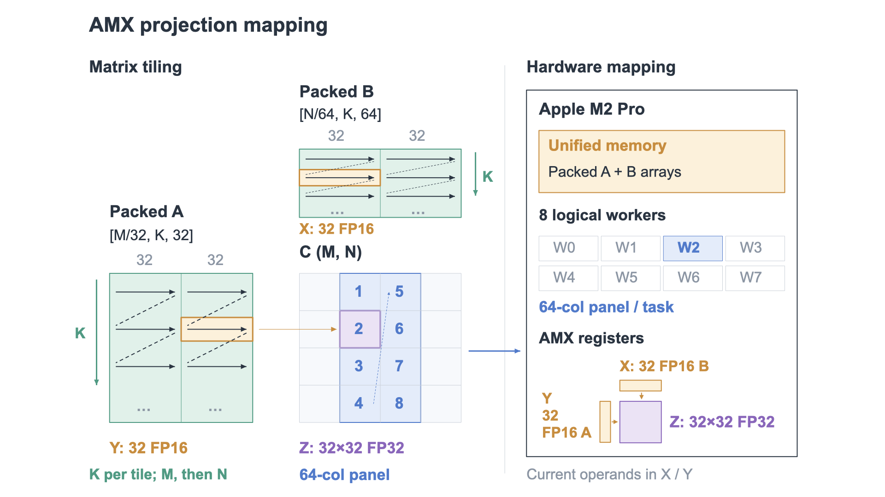{ width="72%" }

/// caption | #fig-15
图 15　把上述安排放回计算域：看 $32 \times 32 \times 1$ 的 atom domain 怎样对应 AMX 的 Y、X、Z，箭头是遍历顺序
///

这里的空间映射、执行顺序、数据放置与指令选择，与 H200 上的 GEMM 用的是同一套写法，变化的是硬件一侧的执行单元、存储与指令契约。

下面的测量比较的是在给定的 native runtime 上各条路径的执行性能，并不是加入这些指令契约前后的对照；计时不包含 prepare、编译与加载[^amx]。AMX 路径把同一份 Q8_0 checkpoint 的投影权重准备为 FP16，与 llama.cpp 的 Q8_0、F16 路径比较：八组测量中，相对 Q8_0 的加速比为 **1.14–1.43×**，相对 F16 为 **1.01–2.11×**。三条路径在投影计算中采用的数值运算方式不同（[图 16](#fig-16)）。

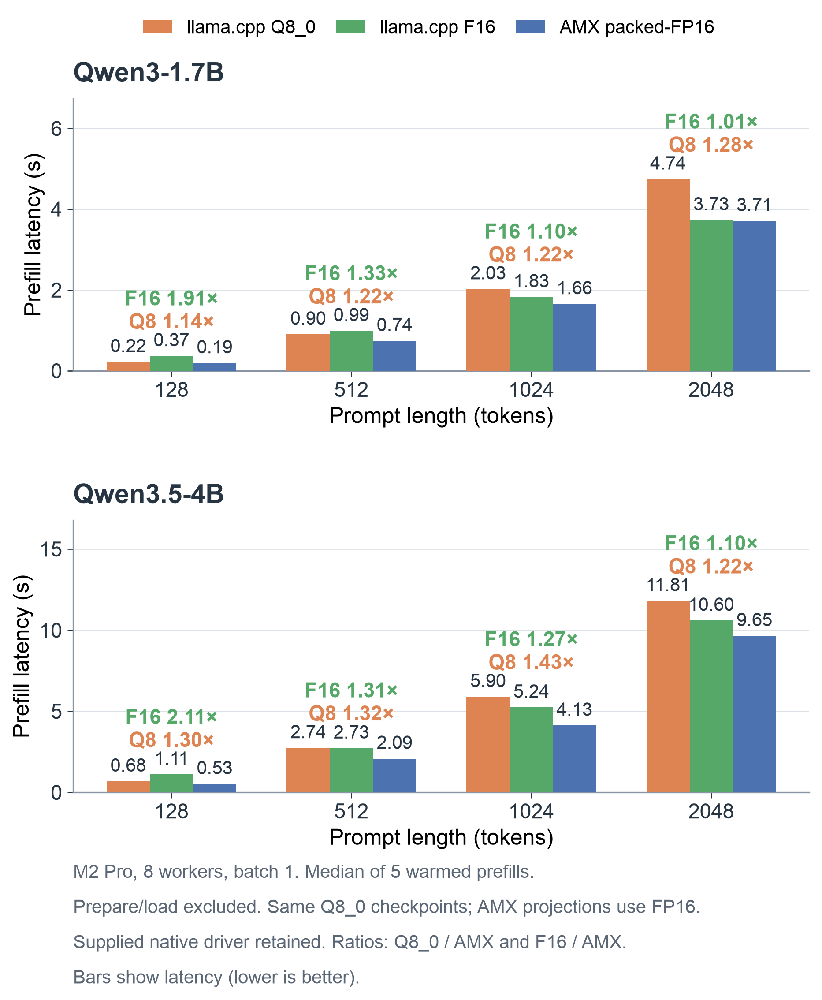{ width="65%" }

/// caption | #fig-16
图 16　M2 Pro 上两个模型的 Prefill 性能，比较 AMX packed-FP16、llama.cpp Q8_0 与 F16 路径
///

### TileOPs：用 TileFoundry 构建的算子库 { #tileops }

TileFoundry 源自开源算子库 [TileOPs](https://github.com/tile-ai/TileOPs) 的开发实践，TileOPs 的全部算子也因此构成检验 TileFoundry 最直接的实验数据。**在 H200 上，[TileOPs v0.1.0](https://github.com/tile-ai/TileOPs/releases/tag/v0.1.0) 的 2,265 行 benchmark 中有 2,262 行不慢于最快的已有实现，几何平均加速 1.37×；按算子计，206 个算子中有 205 个达到 SOTA，其中 172 个是借助 TileFoundry 优化后达到的。**第一个借助 TileFoundry 编写的 PR 合入时，只有 20 个算子已经达到 SOTA（[图 17](#fig-17)）。

TileOPs 的每个算子从一份 YAML spec 开始，spec 声明算子的签名、workload 与 roofline；coding agent 借助 TileFoundry 编写与调优 kernel，相应的 PR 以 [`foundry` 标签](https://github.com/tile-ai/TileOPs/pulls?q=is%3Apr+label%3Afoundry+is%3Amerged) 标记。TileOPs 每晚在 H200 上把每一行 workload 与 PyTorch、FlashInfer、FA3、FLA、vLLM、DeepGEMM、cuBLAS、torch.compile 等已有实现对比，用最快实现的耗时除以 TileOPs 的耗时：比值不低于 0.99，记为不慢于最快的已有实现；一个算子的每一行都满足这一条件，记为达到 SOTA。行级结果取自 v0.1.0 发布提交上的 [nightly run](https://github.com/tile-ai/TileOPs/actions/runs/40344177035)，算子级结果取自 10 月 28 日的 nightly[^tileops]。

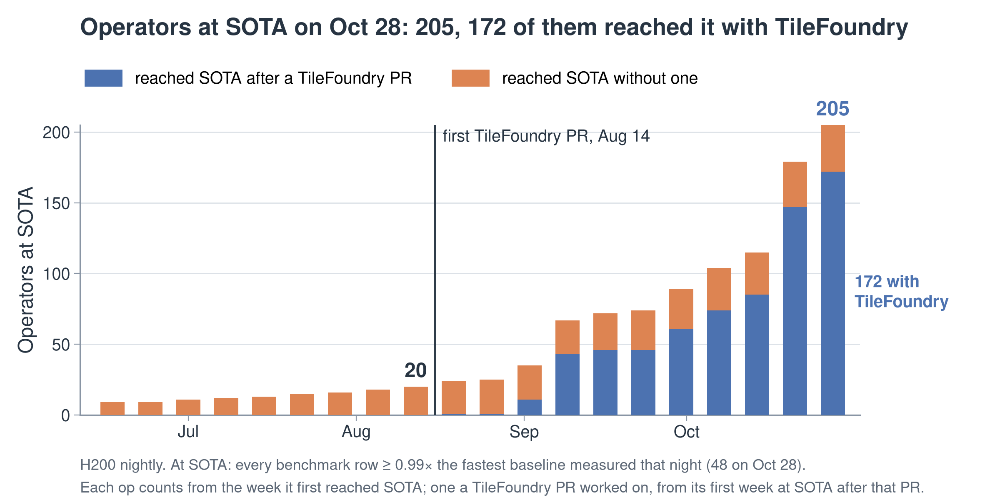{ width="78%" }

/// caption | #fig-17
图 17　TileOPs 中达到 SOTA 的算子数（H200），蓝色是经 `foundry` PR 优化后达到的部分
///

TileOPs 的开发过程，也是 TileFoundry 逐步形成的过程。在此之前，TileOPs 尝试过多种让 agent 参与开发的方式，都遇到了相同的问题：agent 的尝试容易发散，优化收敛困难且缓慢；不断累积的尝试还使 codebase 持续膨胀，日益难以维护。TileFoundry 源于对这一过程的持续反思：它把与决策无关的细节抽象掉，在每个关键的决策点上提供可以查询的事实与可以校验的检查，使 agent 的每一步尝试都有据可依。目前，agent 已经能够借助 TileFoundry，为 TileOPs 持续产出达到 SOTA 的 kernel。

## 小结 { #recap }

高性能 kernel 的核心是一组彼此牵动的决策：数据流怎样切分与调度，计算选用哪些指令。

> TileFoundry 的 atom schedule 把这组决策表示为一个约束优化问题：***与决策无关的细节被抽象掉，每个关键的决策点都提供可以查询的事实与可以校验的检查，而求解的顺序并不预先规定。需要判断与权衡的部分交给 agent；硬件事实、指令契约、对每一步的检查以及代码生成，这些确定的部分则留在系统之中。***

我们相信，schedule 始终是 AI compiler 的核心，这一点并没有因为 agent 的出现而改变；只是当 agent 参与到求解之中，schedule 的形态也需要贴合它的工作特点。过去，pass pipeline 按预先固定的顺序逐级作出决策；如今，决策可以交给 agent，compiler 则负责把问题清晰地表示出来，并在求解的过程中随时给出事实与检查。

正因为如此，抽象对 coding agent 同样重要。Agent 的能力越来越强，但这并不意味着可以把系统摊平，把所有细节都交给它去尝试。语法、编程模型与硬件接口的细节一旦混在一起，agent 的许多尝试就会消耗在与决策无关的地方，优化也更容易变成随机的试错。恰当的抽象让 agent 把推理与判断集中在真正决定性能的问题上。

这一点在新硬件上尤为重要。新硬件往往缺少成熟的编程经验与现成的 kernel，agent 很难从已有的知识中找到答案。在 TileFoundry 中，接入一种新硬件，主要是在 target 与指令契约中写下它的事实；agent 面对的仍是同一个约束优化问题，可以直接着手求解，而不必先在新的语法与接口上反复摸索。我们期待，未来需要长期维护的，只是一份描述计算的高层程序与一组描述硬件的契约；针对每个模型、每台设备、每种使用场景的高性能实现，都在需要时由 agent 在契约之内求解得到。

[^tutorial]: 运行 `tilefoundry tutorial schedule > schedule.md` 可以得到 [tutorial 文档](https://github.com/tile-ai/TileFoundry/blob/25fbbaae20a06a453b4e41920b64fbe425282900/docs/tutorial/schedule.md)，再按页面开头的步骤提取 [`grid.py`](https://github.com/tile-ai/TileFoundry/blob/25fbbaae20a06a453b4e41920b64fbe425282900/docs/tutorial/schedule.md?plain=1#L29-L66)、[`persistent.py`](https://github.com/tile-ai/TileFoundry/blob/25fbbaae20a06a453b4e41920b64fbe425282900/docs/tutorial/schedule.md?plain=1#L87-L128) 与 [`optimal.py`](https://github.com/tile-ai/TileFoundry/blob/25fbbaae20a06a453b4e41920b64fbe425282900/docs/tutorial/schedule.md?plain=1#L256-L364)。下文的 Python 代码和报告都是相关部分的摘录，`...` 表示省略。

[^notation]: 本文用矩阵记法写出 Mesh 与 Layout：每一列是一个 mode，第一行是 extent，第二行是 stride；mode 绑定到 Mesh 轴时，在 extent 后写 `@轴名`；Mesh 的 offset 写在矩阵右侧。

[^h200]: [测量](https://github.com/tile-ai/TileFoundry/blob/1457a80a/examples/qwen3_8_27b_prefill_short-tilelang/BENCH.md)与 SGLang 0.5.21 使用同一张卡、同一份权重，batch 1、无历史、BF16、不量化，两侧都只计完整 forward，逐轮交替测量，各取 60 次计时的中位数。

[^amx]: [测量](https://github.com/tile-ai/TileFoundry/blob/1457a80a/examples/qwen_prefill-amx/README.md)使用 8 个 worker、batch 1、无历史，每种长度预热后测 5 次取中位数，不计 prepare、编译和加载。

[^tileops]: 数据来自 [TileOPs-nightly](https://github.com/tile-ai/TileOPs-nightly/tree/snapshots) 的 benchmark 快照，每周取一晚：NVIDIA H200，SM 时钟锁定在 1500 MHz。一行的比值为最快已有实现的耗时除以 TileOPs 的耗时，不低于 0.99 即计为不慢于最快的已有实现。
